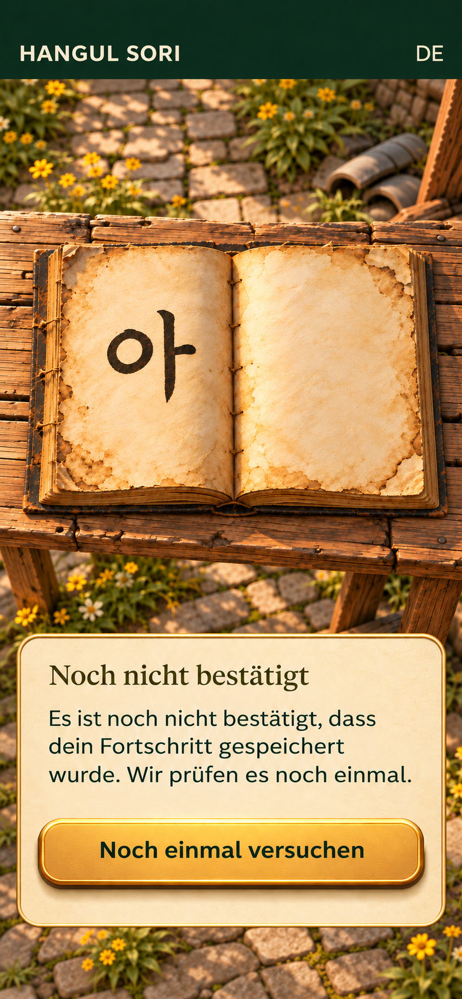

# 최종 파일 분리와 R22 후속 제작

## 2026-11-08 현재 이어 작업

아래의 11월4일 기록은 당시 정리 이력이다. 현재 제작 상태는 [최종 인계](continuation-20261108/HANDOFF.md)와 [15개 상태 갤러리](continuation-20261108/GALLERY.md)를 우선한다. 현재 범위의15개 이야기 상태(기존R22+새14장)가 독립 디자인·서사 정지 이미지 검수를 통과했다. 사용자 승인·정본 승격·앱 적용과는 다르다.

- [R21b 첫 책 대화 마무리](R21b-first-book-closing-de-v8.png): 성체 태고의 네 다리/네 발/꼬리와 수진 대비 어깨 높이를 수정했다.
- [R24a 창고 자재 정리 부탁](R24a-materials-request-de-v4.png): 기존 도깨비·수진과 방망이 지지, 미배치 푯말과 다른 한옥 마루 참고 사진을 보존했다.
- [R26a 연습 기록 대기](R26a-practice-record-de-v2.png): 첫 책의 아를 교체하지 않고 별도 연습 기록장의 집을 표시한다. 정식 쪽지 보관이 아니다.

[원문·상태·제작 요청과 독립 검수 기록](continuation-20261108/)을 함께 전달한다. 반려/미확인 출력은 통과 이미지와 구분한다. 전체52단원이나 시즌의모든발화를 이미지로 만들었다는 뜻이 아니며, main병합·CI·작업트리 정리는 실제 종료 영수증으로 별도 확인한다.

2026-11-04. 이 기록은 사용자 지정 생성 폴더의 104 PNG를 정리한 결과다.

- 사용자 승인 외형 정본 2개: 태고 얼굴·몸통.
- 등록된 정적 제작참조 2개: 표정 8종·자세 6종. 파생 각 컷의 사용자 직접 승인과 다르다.
- 이전 이야기 화면 중 최종 승인 근거가 확인된 화면 0개.
- 나머지 100 PNG는 삭제하지 않고 형제 보관 폴더로 이동. 전후 104개 SHA-256 일치. 공간 회수 0바이트.

[104개 경로 매핑과 무결성 영수증](RELOCATION_RECEIPT.json)에 이전/현재 경로, SHA, 상태와 역할을 기록했다. 미확인은 거절로 바꾸지 않았다. 파일명·생성 날짜·폴더명 final만으로 승인하지 않았다.

## 출처

- [태고 현행 포인터](../../../../canonical/ensemble/TAEGO_CURRENT.json)
- [현행 태고 승인·등록 구분](../../../../canonical/ensemble/20261103-taego-design/ASSET_MANIFEST.json)
- 11월 2일 이야기 이미지 37건 검토: C:/dev/hangulsori/_codex_artifacts/season1-story-image-revision-20261102/REVIEW_INDEX.md.
- [R21b 최신 반려와 단독 후보 기록](../REVIEW_MANIFEST.json). 이 파일의 역사적 원본 경로는 영수증으로 현재 보관 경로를 찾는다. 원래 생성 요청의 경로는 덮어쓰지 않는다.

## R22

원고의 저장 미확인 C-UNCERTAIN/C-TRY를 사용한 독일어 이야기 상태 화면을 별도로 제작한다. 책/서안 클로즈업이므로 등장인물은 없다. 인물 없음은 R21b의 실패 해결이나 인물 정본 변경을 뜻하지 않는다. R21b 수정과 R23 이후는 남아 있다.

Noch nicht bestätigt는 새 UI 상태 요약 문구다. 기존 원고 인용은 본문·CTA만이다. 정지 화면은 실제 저장 성공, 재시도 동작, 글자 확대·기기 검증 또는 정본 UI 바이트 배치를 인증하지 않는다.

## 전달한 R22 검수본

- **853×1843 RGB PNG**, SHA-256: 841979563167f299c86bc202e65b451b3b520935ff8935f69972fe17ea75f40c.
- [독립 디자인 검수](R22_DESIGN_POSTFLIGHT_V4.md)와 [독립 이야기 검수](R22_STORY_POSTFLIGHT_V4.md) 모두 정지 이미지 범위 PASS.
- **사용자 승인 전 검토본**이며 캐릭터 정본·앱 화면 적용·저장 동작 검증으로 승격하지 않는다.
- [전체 상태와 제한](R22_REVIEW_MANIFEST.json), [원문·참조 근거](R22_SOURCES.json), [최종 생성 지시](R22_PROMPT_V4.json).
- V1–V3는 내용 검수와 별개로 화면 비율 실패를 유지한다. V4는 첫 참조의 세로 캔버스만 사용해 853×1843으로 출력했다. 첫 참조의 구름·영어·건축·설정·코인·복원 수치는 사용하지 않았다.
- 3개 실패 시안은 기존 보관 폴더에 추가하고, V4는 별도 검토 폴더에 옮겼다. [4개 추가 생성물 이동 영수증](R22_RELOCATION_RECEIPT.json).

현재 사용자 생성 폴더에는 기존 승인/등록 4 PNG만 남는다. 기존100장과 새 비율 실패3장은 보관 폴더의103 PNG로 보존하고, 새 검토 폴더에는 R22 V4 한 장만 둔다. 원래104개와 새4개 전체108개를 해시로 확인하며, 보관은 영구 삭제나 디스크 공간 확보가 아니다.

이 패키지의 검수 문서·프롬프트에 적힌 원래 생성 경로는 실행 당시 근거다. 이동 이후에는 두 영수증의 verified_current_path로 찾는다. 실패본의 원래 경로를 새 정본으로 대체하지 않는다.
