# 시즌1 이야기 연결 목업 — 15개 상태

2026-11-08. 독립 디자인·서사 정지 이미지 검수 통과 후보. 사용자 승인·정본 교체·앱 적용은 별도다. 정확한 크기·해시·출처는 [STATUS.json](STATUS.json).

R21b→R22(보관 미확인) 또는 R23(실제 확인). R24a/b는 각각 착공·완공 이야기 조건. R26a/g는 연습 기록/중단 분기이며, 조건 충족 후 b→c→d(미확인) 또는 e(확인)→f. R27은 실제 다시 질문/반복 뒤의 본편 반응이며 도움 경로를 독립 숙달로 바꾸지 않는다.

## R21b

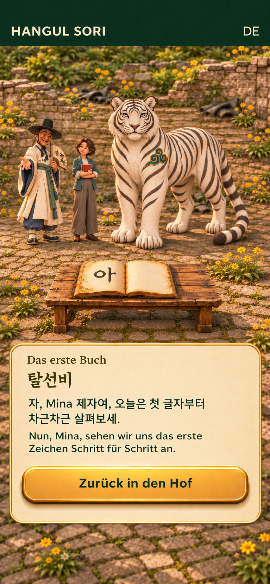

## R22

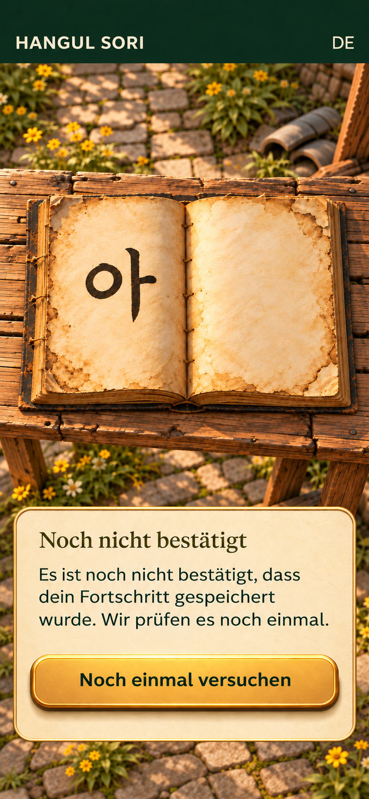

## R23

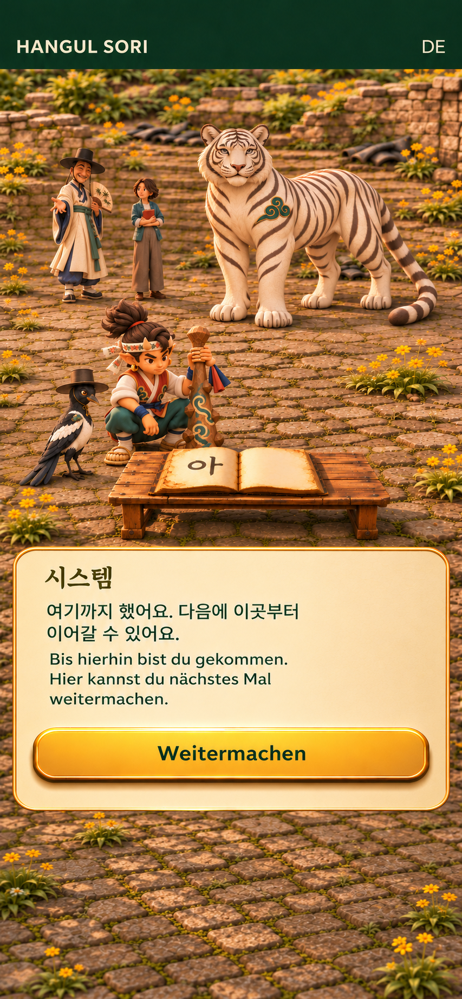

## R24a_request

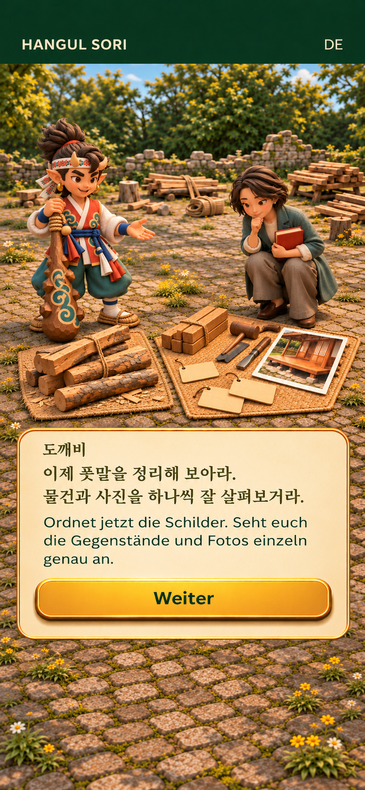

## R24b_discovery

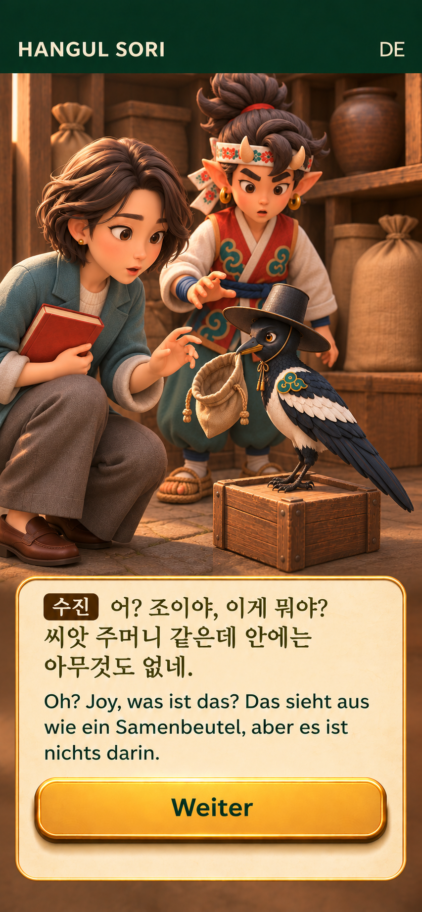

## R25_labels

## R26a_draft_wait

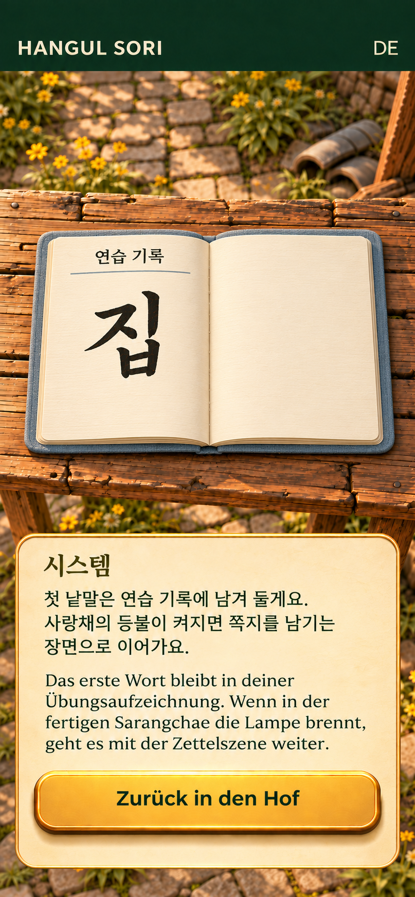

## R26b_lamp

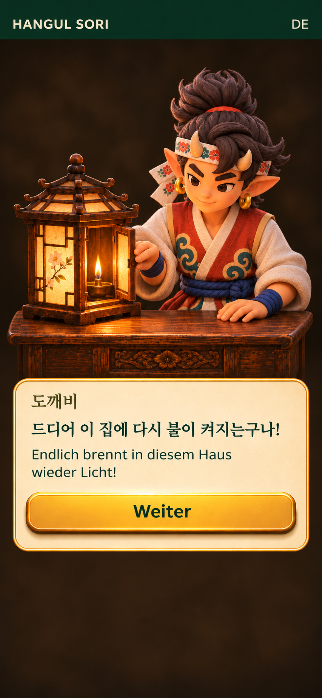

## R26c_write

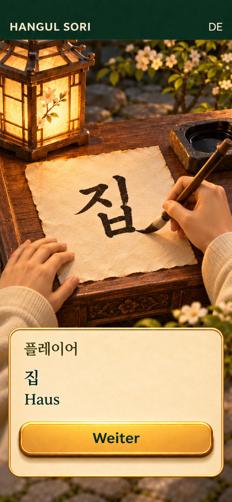

## R26d_pending

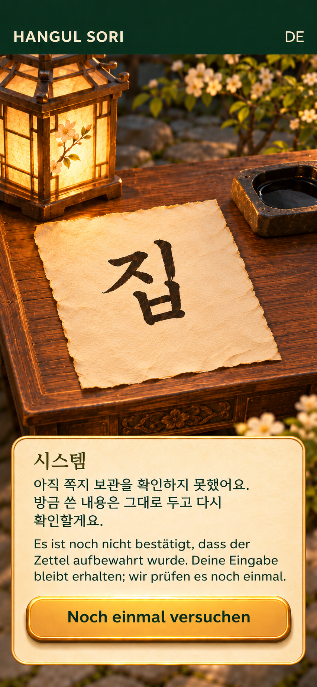

## R26e_kept

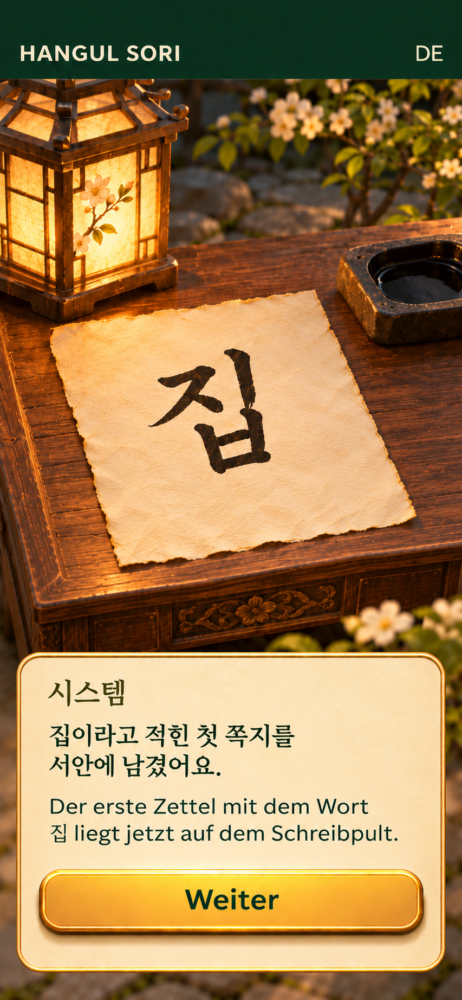

## R26f_bookmark

## R26g_pause

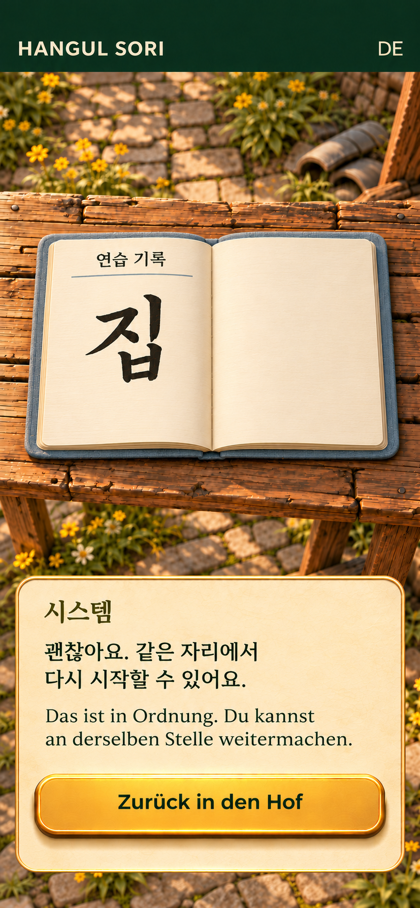

## R27a_entry

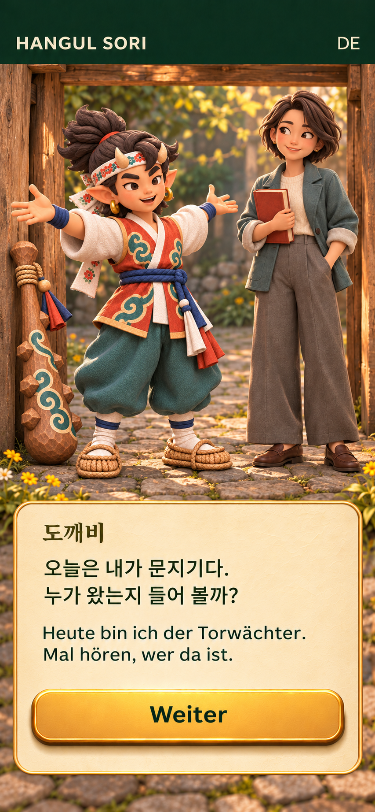

## R27b_step_aside

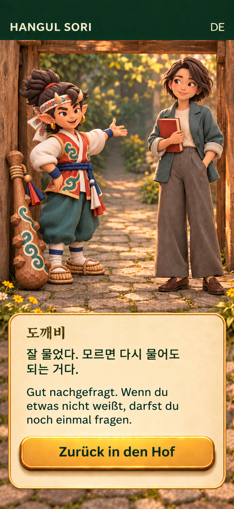
