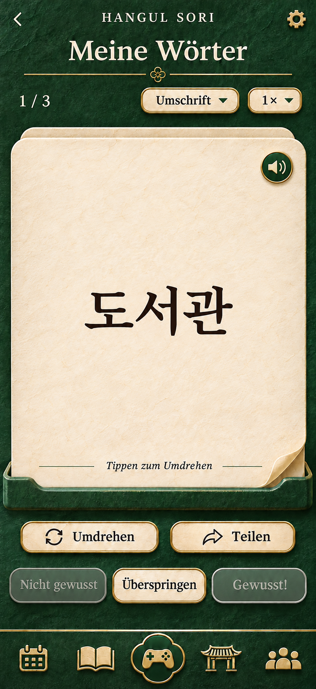
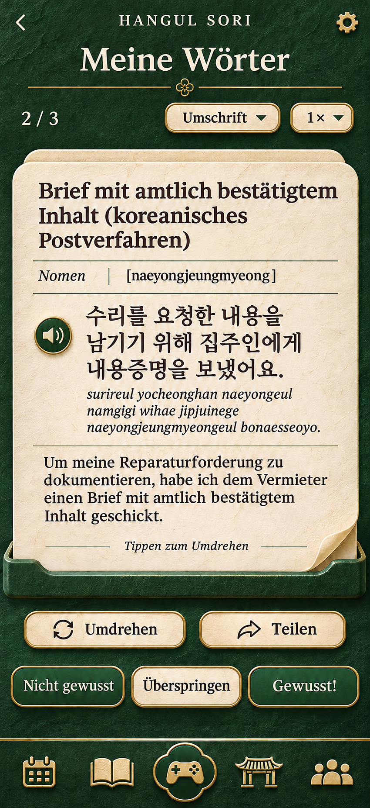
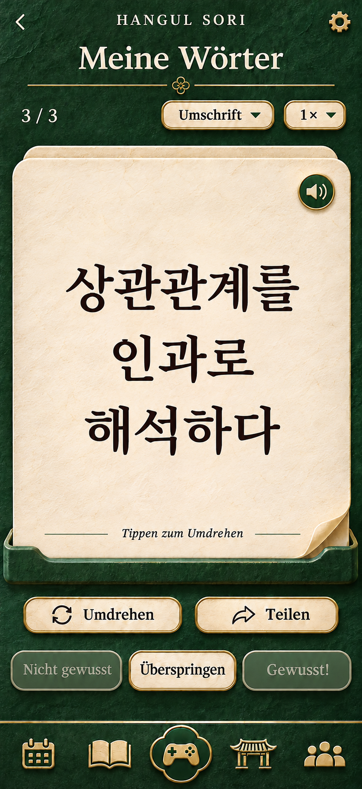

# Karten · 콘텐츠 길이별 이미지 목업

2026-11-04. Quiz·Matching Flutter 구현 커밋 `9bb104377` 이후 제작한 다음 콘텐츠 후보입니다. 기존 Karten을 확장한 검토 세트이며, 새 게임이나 승인된 Flutter 화면으로 취급하지 않습니다.

| A · 짧은 단어 앞면 | B · 긴 뜻과 예문 뒷면 | C · 긴 표현 앞면 |
|---|---|---|
| [도서관](images/karten-a.png) | [내용증명](images/karten-b.png) | [상관관계를 인과로 해석하다](images/karten-c.png) |

## 설계 판단

- 회상 → 뒤집기 → 자기평가가 중심입니다. 한 장의 분리된 한지 카드와 낮은 옥색 받침을 사용해 Quiz의 선택판·Matching의 짝 카드와 다른 조작감을 제안합니다.
- A/B/C의 상단, Umschrift 메뉴, 속도, 공유·뒤집기, 자기평가, 5탭 배치는 통일했습니다. 학습 내용의 길이와 앞·뒷면 상태로 정보 밀도를 조절합니다.
- A/C는 뜻을 숨긴 앞면이며 `Nicht gewusst`·`Gewusst!`는 비활성입니다. B는 펼쳐 본 뒷면이라 두 평가가 활성입니다. 공개 자체를 정답으로 표시하지 않습니다.
- B의 긴 뜻, 한국어 예문, 로마자, 독일어 번역을 모두 보존했습니다. 문장마다 새 소품을 만들거나 내용을 지우지 않았습니다.
- 현재 앱에 있는 음성·속도·Umschrift·뒤집기·공유·건너뛰기·자기평가 기능을 기준으로 구성했습니다. 새 점수·보상·CEFR 필터를 추가하지 않았습니다.

실제 원문은 `assets/data/korean_vocab.csv`의 `vocab_a1_0071`, `vocab_b2_0539`, `vocab_c1_0016`입니다. A/B/C는 검토 이름이며 앱에 새 레벨 선택기를 뜻하지 않습니다. 1/3·2/3·3/3은 명시적으로 구성한 검토용 3개 항목이며 사용자 진도가 아닙니다.

## 제작·검수 경계

내장 `image_gen`으로 생성·수정했습니다. 원본 경로·해시·크기는 `MANIFEST.json`, 사용한 프롬프트는 `PROMPTS.json`, 독립 검토는 `REVIEW.md`에 보관합니다. 최종 PNG는 프로젝트 안에 복사했으며 원본을 삭제하지 않았습니다.

정적인 이미지 후보입니다. 실제 48dp 터치 영역, SafeArea, 시스템 글자 확대, 모든 콘텐츠 길이, 모션·음성·저장은 Figma/Flutter 단계에서 별도로 검증해야 합니다. 생성된 설정·네비게이션 아이콘은 스타일 제안이며 정본 파일을 대체하지 않습니다. 후속 Figma에서는 `공통UI정본/CANONICAL_UI.json`의 구름·설정과 승인 5탭 원본을 별도 레이어로 배치하고, 한글·독일어·진도·버튼 라벨은 실제 텍스트로 재구성합니다. 화면 전체 PNG를 앱 배경으로 사용하는 계획이 아닙니다.

2026-11-04 확인한 [Android 접근성 가이드](https://developer.android.com/guide/topics/ui/accessibility/apps)의 조작 크기·명확한 상태 전달을 후속 구현 기준으로 유지합니다. 승인된 한글소리 재질을 다른 플랫폼 스타일로 치환하지 않습니다.
