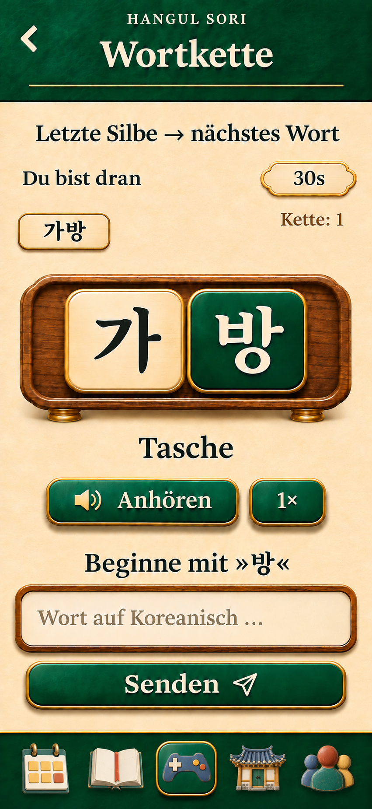
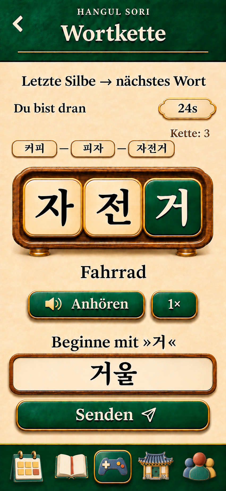
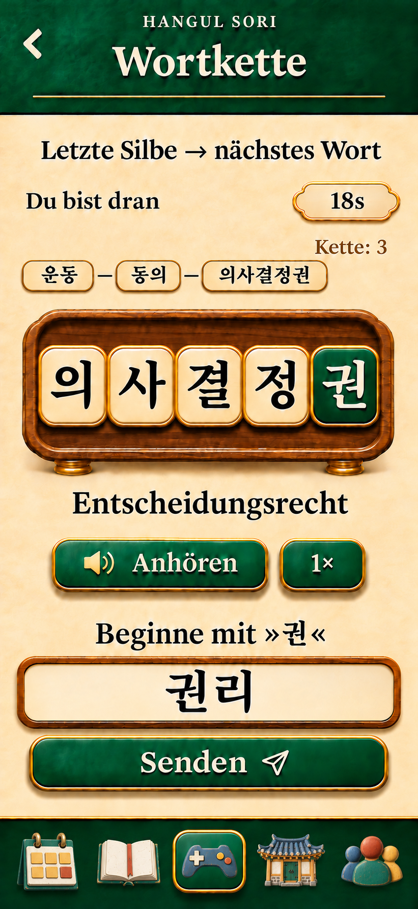

# Wortkette / 끝말잇기 — next Spiele image candidates

2026-11-04. The next game develops the existing word-chain interaction: read the last syllable, enter a new Korean word beginning with it, then submit. Its wooden syllable stand and inset writing surface express this interaction instead of recycling Quiz's answer stack, Matching's pair grid or Karten's two-sided card.

| Candidate | Actual source word | Next input |
|---|---|---|
| [A · short](images/wortkette-a.png) | 가방 · Tasche | Start with 방 |
| [B · medium](images/wortkette-b.png) | 자전거 · Fahrrad | 거울 |
| [C · long](images/wortkette-c.png) | 의사결정권 · Entscheidungsrecht | 권리 |

A/B/C are 2-, 3-, and 5-syllable content-length fixtures, not invented game difficulty filters. Exact source levels and legal chain transitions are recorded in [SOURCE_BRIEF.md](SOURCE_BRIEF.md). Counts and timers are authored review snapshots, not learner progress.

All three include five image tabs with Games selected. These generated mockup glyphs are visual placeholders; they are not byte-exact canonical asset exports. The actual Meine Wörter footer uses verified original PNGs, documented separately in `../karten_navigation_20261104/`. The canonical cloud remains a later independently placed PNG, not a generated imitation.

Root visual review checked final Korean words, German glosses, last-syllable emphasis, draft/chain count separation, five-tab order, and visible CTA clearance. [CANDIDATE_REVIEW.md](CANDIDATE_REVIEW.md) records the designer's checks and limitations. The initial blank navigation dock was replaced in these final images; those intermediate images remain outside the repository.

These are image proposals, not editable Figma, Flutter, motion or physical-device validation. Keyboard-open, opponent, validation error, timeout, results, accessibility and full-corpus fitting remain later design/implementation states. No new gameplay, reward or persistence contract is implied.

