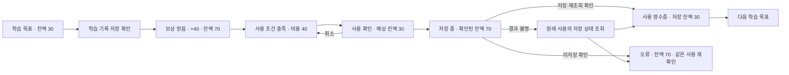

# 엽전 보상 시스템: 화면·입체 반응·모션 방향

2026-10-11 구현·실제 렌더 검수 반영. 담당 범위는 **학습 조건 안내 → 확인된 엽전 지급 → 잔액 → 사용 비용 확인 → 저장 결과 → 다음 학습으로 연결**이다. 시각 정본은 사용자가 지정한 `C:\Users\vjinn\.codex\generated_images\도깨비엽전` 폴더와 그 폴더의 이미지에 SHA-256이 일치하는 기존 C안이다. 한옥 시안은 연결 목적만 참고한다. 한옥 메인, 건물 그림, 건설 진도, 건설 애니메이션, 문화·가구 화면은 한옥 담당 영역이다.

작업 위치: `C:\dev\hangulsori\ko_lernen_app_worktrees\yeopjeon-c-mockups-20261009`, 브랜치 `session/yeopjeon-c-mockups-20261009`, 기준 HEAD `44727c1921b4b7f40748ac0d210d0ca62a094028`. 이 폴더의 HTML 목업에서 보상 장면 두 개와 지원 화면 다섯 개를 직접 조작할 수 있게 연결했다. 기존 미커밋 Flutter 작업은 보존했다. 아래 상태·모션 방향과 HTML 구현 근거를 구분하며, Flutter·실기기 완료 판정은 별도다.

사용자가 느낄 변화는 **“누르면 눌리고, 지급이 확인되면 잔액이 반응하고, 저장이 확인되면 영수증이 남는다”**이다. 기존 C안 에셋을 앞면·두께·접촉 그림자로 조합하고 짧은 물리 반응을 더한다. 현재 화면 목적에는 입체적인 2D 레이어가 적합하다. 실제 3D 엔진 도입은 이 흐름의 선행 조건이 아니다.

화면별 주인공을 분리한다. 동일한 대형 엽전 장면을 모든 화면에 반복하는 구성을 종료한다. 작은 엽전 표시는 공통 잔액 표시로 사용한다.

| 화면 | 한눈에 알려줄 정보와 주요 행동 | 에셋·입체 표현 |
|---|---|---|
| 첫 학습 보상 R01 | 이미 확인된 첫 학습 지급 +20, 이전 10 → 저장된 30, 현재 목표 또는 학습으로 이동 | 기존 도깨비 원본 연기 → 최종 정지 장면. 별도의 읽기 전용 영수증이며 아래 +40 흐름에 지급을 추가하지 않는다. |
| 목표 현황 W03 | 현재 30, 실제 학습 조건, 학습으로 이동 | 기존 책 에셋과 한지 목표 카드. 보상을 이미 받은 것처럼 연출하지 않는다. |
| 보상 받음 R03 | 확인된 +40, 이전 30 → 저장된 70, 다음 행동 | 원본 도깨비 연기 또는 기존 엽전 장면이 중심. 대형 엽전 연출은 이 화면에 집중한다. |
| 사용 가능 W04 | 확인된 잔액 70, 학습 조건 충족, 비용 40, 사용 검토 | 한지 잔액 카드와 간결한 조건·비용 카드. 건물 그림·건설 진도 대신 한옥 담당이 제공하는 사용 대상 이름을 표시한다. |
| 사용 확인 B01 | 현재 70, 사용 40, 이후 **예상** 30, 취소 또는 확정 | 짧은 확인 시트. 확인 전에 저장 잔액이 30으로 바뀌지 않는다. |
| 저장 완료 B03 | 확인된 사용 −40, **저장된** 잔액 30, 영수증 | 한지 영수증. 집이 커지는 장면은 한옥 담당 흐름으로 연결한다. |
| 다음 학습 W05 | 실제 다음 목표, 현재 잔액, 학습으로 이동 | 기존 책과 목표 카드. 미완료 목표에 새 보상 숫자를 만들지 않는다. |

독일어는 `Aktuelles Guthaben`, `Danach voraussichtlich`, `Gespeichertes Guthaben`, 영어는 `Current balance`, `Expected balance after`, `Saved balance`로 시점을 구분한다. `Bereit zum Bauen / Ready to build`는 사용 조건을 설명하는 연결 화면이다. 한옥 탭의 전체 화면을 복제하지 않는다.

| 발생 조건 | 구체적인 반응·권장 시간 | 상태 규칙·동작 줄이기 |
|---|---|---|
| 황동 CTA 접촉 | 윗면이 3~4px 내려오고 받침 그림자가 짧아짐. 누름 120~150ms, 복귀 240ms. 모바일에서는 가벼운 선택 햅틱 1회 검토. | 터치 영역은 고정 48dp 이상. 동작 줄이기에서는 이동 대신 면 밝기·테두리로 접촉을 표시한다. |
| 사용자가 실제로 눌러볼 수 있는 카드 접촉 | 앞면 조명 변화와 최대 약 1° 기울기. 텍스트와 터치 영역은 고정. | 정보 전용 카드에 클릭 가능해 보이는 반응을 넣지 않는다. 화면 전체가 마우스나 기울기에 따라 흔들리는 효과는 제외한다. |
| 확인된 지급 영수증 도착 | 원본 도깨비 연기 1회 → 최종 정지 장면. 기존 840ms 잔액 반응과 한 번의 파란 불꽃 반응을 같은 지급 표현에 맞춘다. 페이지를 가로지르는 엽전 이동은 추가하지 않는다. | `receiptId` 단위로 1회 표시. 영상 cue와 애니메이션은 지급 명령을 호출하지 않는다. 동작 줄이기·건너뛰기·재진입에서도 같은 확정 잔액을 보여준다. |
| 학습 조건 확인 → 사용 가능 | 조건 문구가 `완료`로 바뀌고 황동 강조가 200~280ms 동안 한 번 정착한다. | 완료를 색만으로 전달하지 않는다. 접근성 읽기 순서에도 완료와 사용 가능 이유를 넣는다. |
| 사용 확인 열기 | 확인 시트가 200~280ms 동안 이동·정착. 비용과 예상 잔액을 함께 읽을 수 있다. | 키보드 포커스를 제목 또는 첫 의미 있는 요소로 이동. 취소하면 원래 CTA로 복귀한다. 동작 줄이기에서는 즉시 전환한다. |
| 사용 저장 요청 | CTA가 `저장 중`으로 바뀌고 중복 누름을 차단. 진행 표시는 요청이 실제로 진행되는 동안만 유지한다. | 서비스 응답이 상태를 소유한다. 일정 시간의 애니메이션 완료를 성공 조건으로 삼지 않는다. |
| 저장 후 재조회 확인 | 영수증이 250~320ms 동안 자리 잡고, 저장 잔액 30을 강조. 성공 햅틱은 읽어온 결과가 확인된 뒤 1회 검토. | 저장 성공 전 성공 도장·건물 성장·잔액 차감을 표시하지 않는다. 동작 줄이기에서는 완료 문구와 확정 수치가 즉시 나타난다. |
| 미저장·결과 불명 | 미저장은 이유와 같은 사용의 재확인을 표시. 결과 불명은 저장 상태 조회를 우선 표시. | 금액을 흔들거나 빨간 점멸로 실패를 연출하지 않는다. 결과가 불명일 때 새 사용 요청을 중복 생성하지 않는다. |
| 다음 목표 열기 | 목표 카드가 200~260ms 동안 정착하고 학습 CTA로 시선이 이어짐. | 목표 본문·학습 입력·TTS를 방해하는 반복 움직임은 넣지 않는다. |

이 시간은 프로젝트의 초기 조정값이다. 공식 자료에서 정해준 수치로 취급하지 않는다. 상태와 피드백을 이해시키는 움직임이라는 방향은 [Apple Motion](https://developer.apple.com/design/human-interface-guidelines/motion), 상호작용에 일관된 물리 반응을 적용한다는 방향은 [Material 3 Motion](https://m3.material.io/styles/motion/overview/how-it-works)을 참고했다. 비취·한지·황동은 승인된 C안의 재료감으로 유지한다.

공통 컴포넌트는 다음과 같이 정리한다.

| 컴포넌트 | 구조·상태 |
|---|---|
| 잔액 표시 | 라벨 → 작은 엽전 → 숫자 → 단위. 확인된 잔액과 표시 애니메이션 값을 분리한다. 로딩·확정·오류를 색과 숫자만으로 전달하지 않는다. 숫자 폭은 고정해 흔들림을 줄인다. |
| 학습 조건 카드 | 실제 목표 제목 → can-do 본문 → 진행 상태 → 실제 학습 경로. 학습 완료는 저장된 기록으로 판단한다. |
| 사용 조건·비용 카드 | 대상 이름 → 학습 조건 → 비용 → 확인 행동. 한옥 담당이 전달한 대상과 비용을 그대로 사용한다. 내부 stage ID나 fixture ID는 UI에 노출하지 않는다. |
| 황동 CTA | 윗면·받침·윗면 조명·접촉 그림자·라벨·보조 화살표. 기본/눌림/키보드 포커스/비활성/저장 중 상태를 공통화한다. 내부 에셋의 테두리가 또 다른 버튼 테두리처럼 보이지 않는지 검사한다. |
| 확인 시트·영수증 | 확인 시트는 현재·비용·예상 값을 구분. 영수증은 확인된 지급/사용과 저장된 잔액을 표시. 실패와 결과 불명은 별도 상태다. |

간격은 관련 요소 4~8dp, 묶음 12~16dp, CTA 사이 8dp로 시작한다. 제목·본문·라벨·금액에 공통 글자 토큰을 쓰고 금액이 다른 정보를 밀어내지 않도록 한다. 402×874·100%에서 주요 행동까지의 높이를 확인하고, 200% QA에서는 문구를 잘라내지 않고 스크롤과 재배치로 읽기·조작을 유지한다. 확인 시트의 포커스, 취소 후 복귀, 버튼 내부 화살표, 텍스트와 이미지 경계도 검사한다.

현재 Flutter 소스에서 확인한 기반과 다음 적용 지점:

| 소스 | 현재 확인한 기능 | 다음 작업 |
|---|---|---|
| `lib/screens/sori_stage/yeopjeon_reward_screen.dart` | 확인된 `RewardReceipt`와 `yeopjeonWalletAfter`로 화면을 구성. 도깨비 cue는 표시 상태를 바꾸며, 화면을 떠날 때 표시를 정착. 방문 후 저장된 지갑을 다시 읽는 연결이 존재. | 보상·잔액·사용 안내의 역할을 분리하고, 한옥 담당 경로에 대상·지갑을 전달하는 연결 계약을 맞춘다. |
| `lib/widgets/sori/pressable.dart` | `surfaceDepth`, 받침 색, `tactileTilt`, 눌림·복귀, 동작 줄이기 경로가 존재. | 엽전 시스템 CTA에 일관된 깊이·조명·시간 토큰을 적용한다. 일반 정보 카드를 버튼처럼 만들지 않는다. |
| `lib/widgets/sori/dokkaebi_reward_movie.dart` | 원본 연기, 지급 표현 cue, 최종 정착이 분리돼 있다. | 기존 정본의 구도·파란 불꽃·contain·1회 재생 후 정지 정책을 유지한다. 화면 밖·백그라운드·동작 줄이기에서 같은 결과를 확인한다. |
| `lib/widgets/sori/yeopjeon_credit_badge.dart` | 영수증과 이전/확정 잔액을 받은 잔액 반응이 존재. 현재 컨트롤러 길이는 1040ms이며 기존 840ms 잔액 변화와 200ms 정착을 먼저 검토한다. | 기존 반응을 먼저 실기기에서 보고, 파란 불꽃·잔액 변화·테두리 정착이 중복되지 않게 조정한다. |
| `lib/services/sori_stage_reward_receipt_service.dart` | 저장·보상 소유권을 가진 기존 서비스 경로. | 디자인 레이어는 영수증과 저장된 결과를 소비한다. 재생·건너뛰기·이중 누름·재진입으로 지급을 추가하지 않는다. |

실행 순서는 ① 화면 역할과 실제 상태 계약 ② 공통 카드·잔액·CTA의 깊이와 눌림 ③ 지급·조건·저장 확인 모션 ④ Flutter 렌더 및 기기 검수다. 학습 입력·평가·TTS와 한옥 화면 자체는 각 담당 경로로 연결한다.

요청한 스킬은 다음 판단에 적용했다. 이름만 적용했다고 보고하지 않고 프리뷰·소스·검수 결과와 연결한다.

| 스킬 | 이번 설계 결정 |
|---|---|
| [ui-styling](C:/Users/vjinn/.agents/skills/ui-styling/SKILL.md) | 비취 배경, 한지 앞면·받침, 황동 윗면·눌림을 공통 토큰으로 연결. |
| [user-flows](C:/Users/vjinn/.codex/plugins/cache/openai-curated-remote/uiuxdesigner/1.1.0/skills/user-flows/SKILL.md) | 정상 흐름 외 취소·저장 실패·결과 불명·재진입을 연결. 모션이 거래를 생성하지 않게 설계. |
| [information-architecture](C:/Users/vjinn/.codex/plugins/cache/openai-curated-remote/uiuxdesigner/1.1.0/skills/information-architecture/SKILL.md) | 보상/잔액/사용 확인을 엽전 담당에, 건물/진도/건설 장면을 한옥 담당에 배치. |
| [ui-ux-help](C:/Users/vjinn/.codex/plugins/cache/openai-curated-remote/uiuxdesigner/1.1.0/skills/ui-ux-help/SKILL.md) | 시각·정보 구조·흐름·컴포넌트·모션·접근성 검토를 작업 단계별로 적용. |
| [layout-grid-hierarchy](C:/Users/vjinn/.codex/plugins/cache/openai-curated-remote/uiuxdesigner/1.1.0/skills/layout-grid-hierarchy/SKILL.md) | 화면당 핵심 정보와 주요 행동 1개를 먼저 배치. 숫자/본문 위계, 4·8·12·16 간격, 402×874 높이 검토. |
| [ux-audit-critique](C:/Users/vjinn/.codex/plugins/cache/openai-curated-remote/uiuxdesigner/1.1.0/skills/ux-audit-critique/SKILL.md) | 대형 에셋 반복, 한옥 영역 확장, 예상/확정 잔액 혼동을 우선 수정 항목으로 지정. |
| [accessibility-audit](C:/Users/vjinn/.codex/plugins/cache/openai-curated-remote/uiuxdesigner/1.1.0/skills/accessibility-audit/SKILL.md) | 48dp, 키보드 포커스·복귀, 완료/오류 문구, 독일어·영어 200% 재배치, 동작 줄이기 경로 검수. |
| [component-design](C:/Users/vjinn/.codex/plugins/cache/openai-curated-remote/uiuxdesigner/1.1.0/skills/component-design/SKILL.md) | 잔액·목표·사용·CTA·시트·영수증의 구조와 기본/눌림/비활성/저장 중/실패/결과 불명 상태를 분리. |
| [ui-ux-pro-max](C:/Users/vjinn/.agents/skills/ui-ux-pro-max/SKILL.md) | 글자 역할별 크기·굵기, 주요/보조 CTA 구분, 내부 장식과 라벨 충돌, 4/8dp 간격을 실제 캡처에서 검토. |
| [mobile-app-ui](C:/Users/vjinn/.codex/plugins/cache/openai-curated-remote/uiuxdesigner/1.1.0/skills/mobile-app-ui/SKILL.md) | 하단 행동 영역과 안전 영역을 유지하고 본문만 스크롤. 독일어·영어 402×874와 작은 화면·확대 글자를 따로 검수. |
| [microinteractions-motion](C:/Users/vjinn/.codex/plugins/cache/openai-curated-remote/uiuxdesigner/1.1.0/skills/microinteractions-motion/SKILL.md) | 사용자 입력과 확정 상태에 반응하는 1회 모션, 모션과 저장 결과의 독립, 동작 줄이기 대안을 정의. |

이번 프리뷰 수정에서 제거한 것은 이 세션이 덧붙인 한옥 진입·건설 그림·진도 표시다. 보상 받음 화면 외 지원 화면에서는 큰 엽전 장면도 제외했다. 검수 근거는 같은 폴더의 `qa-proof/verification.json`에 저장하며, 이 파일은 로컬 HTML과 예시 저장소의 근거다. 실제 Flutter·계정·기기에서의 완성을 입증하지 않는다.

사용자 추가 교정 반영: 본문에서 CTA를 분리해 하단 행동 영역으로 고정했다. 확인창은 내용 스크롤과 하단 확인·취소 버튼을 분리했다. 공통 글자는 제목 28, 섹션 21, 본문·주요 CTA 16, 보조 설명 14, 라벨 13이다. 획득 금액은 56, 일반 잔액은 42, 확인창 숫자는 24로 역할을 구분한다. 기본은 항상 100%다. 150%/200%는 별도 QA 도구에서만 열고, 일반 디자인 검토와 사용자에게 보여주는 결과는 100%로 복귀한다.

원본 재사용 근거: `reward-asset-sources.json`에서 사용자가 지정한 폴더의 파일과 기존 프로젝트 복사본의 동일 SHA-256을 확인할 수 있다. 비취 부조 배경은 `exec-51b8c701-72f6-4553-90ea-a948728ee819.png`, 엽전 장면은 `exec-d8f32401-4538-4c4f-a3d5-bdc5b48d6a4d.png`와 같은 바이트를 사용한다. 금색·비취색 CTA는 기존 `refined.js`의 C안 렌더러를 재사용해 원본 atlas 픽셀과 고정 크기 구름 장식을 보존한다. 다섯 지원 화면의 원본 DE/EN 시안도 같은 폴더의 파일과 해시가 일치하며 검토 링크로 연결한다.

이번 수정본의 HTML 검수: 상태·저장 22개와 보상 표시 16개, 총 **38개 검사**가 통과했다. 실제 클릭 흐름 3개, DE/EN·402×874/375×812·100%/별도 200% 및 동작 줄이기 가로 화면을 포함한 **배치 58개**를 확인했다. 정상 클릭 흐름은 학습 조건 확인 → +40·70 → 사용 검토 → 취소·포커스 복귀 → 중복 누름 → 저장·재진입 → 30 → 실제 다음 목표까지 진행했다. 실패 흐름은 미저장 시 70 유지, 같은 사용 재확인, 성공 후 영수증·30을 검증했다. 402×874·100% 지원 화면의 주요 행동은 스크롤 없이 하단에서 보인다. 별도 큰 글자 검사에서는 본문 스크롤 전후 CTA의 y 좌표와 안전 영역을 확인했다. 원본 CTA의 왼쪽 구름 장식·라벨·오른쪽 화살표도 함께 검사했다.

실행 가능한 현재 구현:

| 범위 | 실제 구현·근거 |
|---|---|
| 연결된 화면 | `preview.html` / `preview.mjs`에서 R01, W03, R03, W04, B01, B03, W05. `index.html` 갤러리에도 획득 장면 두 개를 먼저 배치하고 일곱 화면의 최신 DE/EN 100% 캡처와 조작 링크를 연결했다. |
| 이전 숫자 모션 재사용 | `refined.js` 183–187의 두 줄 숫자 릴을 큰 획득 숫자와 작은 지갑 모두에 적용했다. 90ms 릴 전환, 기존 7단계·840ms 증가, 200ms 정착이 같은 지급 시계에 반응한다. 근거는 `reward-presentation.mjs`, `reward-presentation.test.mjs`, `qa-proof/reel-frame-review.json`이다. |
| 도깨비 영상·숫자 연결 | 기존 원본은 cue 86/24초에서 숫자 반응을 시작하고 1회 재생 후 최종 정지 장면을 남긴다. 재생·재생 건너뛰기·재진입·화면 밖·동작 줄이기는 영수증을 표시할 뿐 지급 함수를 호출하지 않는다. 접근성 라벨은 항상 확정 금액을 읽는다. |
| 엽전 장면과 단상 | R03 무대는 220px, 원본 이미지의 실제 높이는 214px와 하단 안전 여백 6px다. 암묵적인 grid 행이 244px로 커져 단상이 24px 잘리던 문제를 수정했다. 원본 비율과 색을 보존하고 단상 앞면·아래 타원을 모두 보이게 했다. 불필요한 금색 바닥 선은 제거하고 좁은 접촉 그림자만 남겼다. `verify-preview.py`는 외곽 카드뿐 아니라 실제 내부 이미지·영상이 무대 밖으로 나가는지도 검사한다. |
| 잔액 효과 | +/++ 글리프는 작은 엽전 이미지 영역에서 한 번 반응한다. 숫자와 글리프 사이에는 실제 렌더에서 8px 여유가 있으며 숫자 자릿수와 카드 폭은 변하지 않는다. |
| 사용·저장 소유권 | `journey-model.mjs`와 `preview-store.mjs`의 확인된 영수증·동결된 사용 요청·저장 후 재조회가 금액을 소유한다. 로컬 저장 키는 `hangul-sori:goal-journey-design:rewards-v2`다. 취소·미저장·결과 불명·중복 입력을 분리했다. 이 저장소는 실제 계정이나 Flutter 서비스가 아니다. |
| 실제 다음 목표 | 기존 A1 목표 `Erste Begrüßung und Nachfragen` 다음에는 `Name und Herkunft nennen`을 연결했다. 다음 학습 진입은 추가 평가나 가짜 지급을 만들지 않는다. |

새 영상 비교는 정본 채택과 분리했다. `gemini_generated_video_5dc2f044.mp4`는 `video=candidate` 검토 링크에서만 볼 수 있다. 비취 구름·비대칭 feather mask로 상하·좌우 경계를 장면에 녹여 단정한 네모 영상창이 나타나지 않게 했다. 얼굴·주요 엽전·파란 불꽃의 중심 영역은 유지하며 원본 비율을 contain으로 표시한다. 실제 재생의 점프 2.413초, 엽전 폭발 5.266초, 자연 종료를 검토했고, 숫자와 같은 cue로 연결했다. `qa-proof/video-candidate-20261011/frame-review.json`, `playback-review.json`, `reward-demo-de-final.webm`이 근거다.

이 후보는 양쪽 큰 뿔과 이마의 작은 돌기가 함께 보여 네 뿔처럼 읽힌다. 후속 `gemini_generated_video_7312599d.mp4`는 기존 앱 캐릭터와의 일관성이 더 좋지만 뒤쪽에 두 번째 폭발이 반복된다. 채택 후보는 후속 영상의 첫 연기 구간으로 권장하며, 현재는 비교만 완료했다. 새 영상을 정본이나 Flutter 에셋으로 승격하지 않았다. `qa-proof/video-comparison-20261011/source-review.json`과 원본 프레임 비교를 참조한다.

기본 검토 링크: [독일어 목표부터 눌러보기](http://127.0.0.1:8793/concepts/reward-suite-20261010/goal-journey/preview.html?lang=de&scene=W03), [영어 목표부터 눌러보기](http://127.0.0.1:8793/concepts/reward-suite-20261010/goal-journey/preview.html?lang=en&scene=W03), [일곱 화면 갤러리](http://127.0.0.1:8793/concepts/reward-suite-20261010/goal-journey/index.html?lang=de). R01의 `Weiterlernen`은 현재 목표, R03의 `Weiterlernen`은 다음 목표로 이어진다.

추가 검수는 `qa-proof/gallery-and-final-check.json`에 남겼다. DE/EN의 일곱 캡처·조작 링크·원본 링크·확대 닫기 후 포커스 복귀, 갤러리 402px 가로 넘침, QA 글자 크기 변경 후 100% 숫자 릴 재생성, 후보 영상의 작은 화면 contain과 동작 줄이기 결과를 확인했다. 최종 리뷰 화면은 DE·402×874·100%다. 시각 디자이너와 모바일 UX 디자이너가 최신 100% 단상과 다섯 지원 화면을 교차 검토했다.

axe 자동 검사 12개에서 감지된 위반은 0개다. 이미지·의사 요소 배경의 색 대비는 자동 판정이 불완전하므로 이 숫자를 전체 접근성 통과 판정으로 사용하지 않는다. 실제 캡처의 글자·배경을 검토했고, 기본 색 토큰의 대비는 `qa-proof/contrast-tokens.json`에 남겼다. 기기의 화면 읽기·동적 글자·프레임 성능·음성·햅틱은 향후 Flutter/실기기 단계에서 검증한다.
